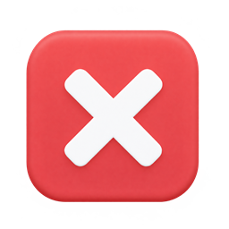

# Status icons / Status-Icons

   

**English:** Four matching, language-neutral status icons, generated for this project with OpenAI's built-in image generation tool. PNG, 256 × 256, transparent, under 200 KiB each. Included under the project's [MIT license](../LICENSE). The final prompt set is in [icons/prompts.json](icons/prompts.json). macOS uses the sender app icon instead of these PNGs.

**Deutsch:** Vier zusammengehörige, sprachneutrale Status-Icons, mit dem integrierten Bildgenerator von OpenAI für dieses Projekt erzeugt. PNG, 256 × 256, transparent, jeweils unter 200 KiB. Enthalten unter der [MIT-Lizenz](../LICENSE) des Projekts. Die verwendeten Prompts stehen in [icons/prompts.json](icons/prompts.json). macOS verwendet stattdessen das Icon der sendenden App.
